# Pocket Scout FC 게임 분석

- 분석 대상 영상: [Pocket Scout FC Gameplay](https://youtu.be/HXHRJK8GDqQ) (채널: Maximumandroid)
- 참고 자료: [App Store 페이지](https://apps.apple.com/us/app/pocket-scout-fc/id6776583457)
- 근거 자료
  - 영상 캡처 프레임 3장 (`images/frame*.jpg`): 게임 시작 직후, Week 1-1
  - **직접 플레이하며 찍은 스크린샷 23장** (`images/screens/*.jpg`): Week 1-2, 스카우트 레벨 10, 로컬 리그 9위 시점, 한국 스토어(원화 가격)

> 클라우드 환경에서 YouTube가 봇 확인을 요구해 영상 전체는 내려받지 못했습니다.
> 대신 실제 플레이 스크린샷으로 대부분의 시스템을 직접 확인했습니다.
> 화면으로 **확인한 내용**과 **추정한 내용**을 구분해 적었습니다.

---

## 1. 기본 정보

| 항목 | 내용 |
|---|---|
| 개발사 | Mobge Ltd (튀르키예의 하이퍼캐주얼/캐주얼 모바일 개발사) |
| 장르 | 캐주얼 **방치형 축구 팀 경영**. 장비 대신 선수를 뽑아 비교하는 구조 |
| 플랫폼 | iOS / iPadOS (Android 출시 여부는 확인하지 못함) |
| 버전 | 0.1.1(6월) → 0.2.8 (1.0 이전, 업데이트가 잦은 단계) |
| 수익 모델 | 무료 + 보상형 광고 + 인앱 결제 + 주간 구독 + 시즌 패스 |
| 평점 | 4.7 / 5 (리뷰 225개) |
| 화면 | 세로 화면, 한 손 조작, 픽셀 아트 |

## 2. 화면 구조

하단 탭 5개: **TOURNAMENT · TRAINING · MATCH · TACTICS · STORE**. 처음에는 MATCH만 열려 있고 진행하면서 하나씩 열립니다. 모든 탭에 빨간 알림 점이 붙어 있어서 탭을 계속 돌아보게 만듭니다.

**MATCH 탭(메인 화면)** 위에서 아래로:
1. 진행도(`Week 1-2`, 3칸 게이지), 현금, 젬
2. 스코어보드: 내 팀(이름은 플레이어가 정함. 예: `Man U`)과 팀 파워 vs 상대 팀과 팀 파워. 아래에 장착한 스킬 3개 아이콘 표시
3. 경기 화면: 위에서 본 2D 피치, 선수 이름표, 경기 시계(20:26, 34:04 등), **해설 자막**("A composed spell of passing here.", "Cool as you like from Sirlard Contay!"), 확대/축소 버튼, `GOAL` 연출
4. 팀 스탯 바: ATTACK / MIDFIELD / DEFENCE / TEAM POWER
5. 포메이션 보드: 선수 카드 11장. 카드 배경색이 선수 등급을 나타냄
6. 버튼 줄: 판매/이적(전화+$), 리그 배지와 순위(`9th`), **스카우트(쌍안경)와 남은 스카우트 수(2.6k)**, `Scout Level 10`, `Auto` 자동 스카우트(+14)
7. 오른쪽 위에 떠 있는 버튼: `PROGRESS PASS`, `CLUB MEMBERSHIP` 결제 진입점

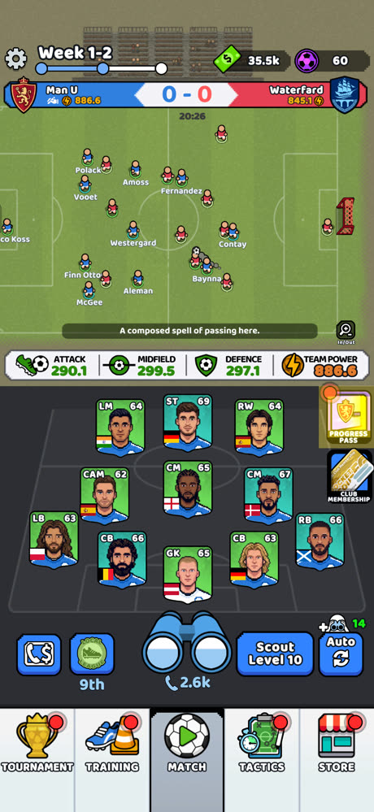

## 3. 핵심 루프: 스카우트 → 비교 → 영입 또는 판매

```
스카우트 1회 사용(쌍안경, 전화 아이콘 재화 1개 소모)
  → 확률표에 따라 등급이 정해진 선수 1명 등장
  → 같은 포지션의 현재 선수와 6개 능력치를 비교 (↑ 초록 / ↓ 빨강)
  → [Sign Player] 영입해서 교체  /  [Sell] 팔아서 현금
  → 팀 파워 상승 → 경기 자동 진행 → 승점, 리그 순위
  → 현금으로 Scout Level 업그레이드 → 상위 등급이 나올 확률 상승 → 반복
```

### 3-1. 선수 카드 (확인)

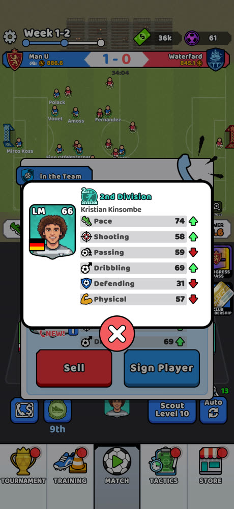

- **포지션 + 종합 능력치**(예: `LM 66`), 국기, 등급 배지와 등급명, 이름
- 능력치 6개: **Pace, Shooting, Passing, Dribbling, Defending, Physical**
- 능력치는 세 단계로 나눠 보여 줌
  - **비교 팝업**: 포지션 핵심 능력치 **2개**만 위아래로 비교 (ST는 Pace/Shooting, GK는 Passing/Defending)
  - **ⓘ 상세 팝업**: 6개 전부, 현재 선수 대비 ↑↓ 표시 (위 스크린샷)
  - **포메이션 카드 탭**: 3개 요약 (LM은 Pace/Shooting/Dribbling)
- 비교 팝업에는 핵심 능력치 2개만 있어서 **0.5초 만에 영입/판매를 판단**할 수 있음. 자세히 보고 싶은 사람만 ⓘ를 누름

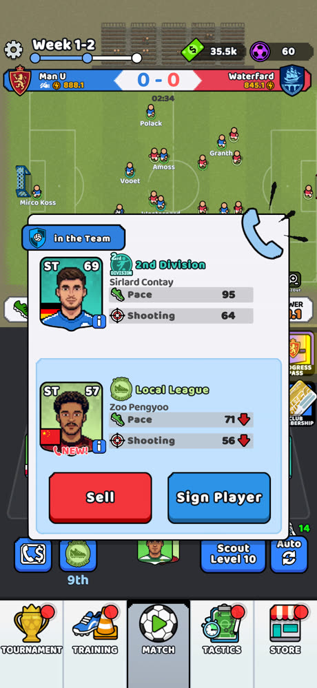

- 같은 ST라도 2nd Division 69(Pace 95)와 Local League 57(Pace 71)처럼 등급 차이가 능력치에 크게 드러남
- 포지션은 고정이 아님. 초반에는 LW였는데 나중 스크린샷에서는 LM. 카드의 포지션이 그대로 슬롯에 들어가는 것으로 추정

### 3-2. 선수 등급 9단계 (확인)

| # | 등급 | 카드 색 |
|---|---|---|
| 1 | Amateur | 회색 |
| 2 | Local League | 연두 |
| 3 | 3rd Division | 초록 |
| 4 | 2nd Division | 청록 |
| 5 | Semi-Pro | 파랑 |
| 6 | Professional | 보라 |
| 7 | Elite | 노랑 |
| 8 | World Class | 주황 |
| 9 | Superstar | 분홍 |

**선수 등급 이름이 리그 단계 이름과 같습니다.** 지금 소속이 `Local League`이고 리그 배지도 똑같은 신발 아이콘입니다. 선수 등급과 구단 성장 단계를 하나의 사다리로 묶어서, 다음에 무엇이 오는지 직관적으로 알 수 있게 했습니다.

### 3-3. 스카우트 확률과 스카우트 레벨 (확인)

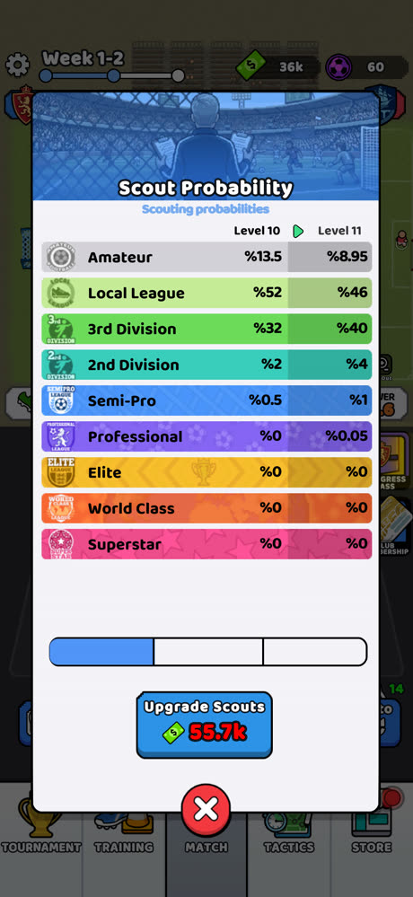

| 등급 | Lv10 | Lv11 | 변화 |
|---|---|---|---|
| Amateur | 13.5% | 8.95% | ▼ |
| Local League | 52% | 46% | ▼ |
| 3rd Division | 32% | 40% | ▲ |
| 2nd Division | 2% | 4% | ▲ (2배) |
| Semi-Pro | 0.5% | 1% | ▲ (2배) |
| Professional | 0% | 0.05% | **처음 등장** |
| Elite / World Class / Superstar | 0% | 0% | – |

- 확률 합계는 두 레벨 모두 100%입니다. **확률을 공개**한다는 점이 좋습니다(한국 확률형 아이템 표시 규제에도 맞음).
- 레벨을 올리면 아래 등급 확률이 위로 옮겨 가는 구조입니다. 바로 위 두 등급 확률은 두 배씩 오르고, **새 등급이 0.05%로 처음 열리는 순간**이 다음 업그레이드 동기가 됩니다.
- 업그레이드 비용: Lv10에서 11로 가는 데 **현금 55.7k**. 스크린샷 시점 보유액은 36k라 비용이 빨간색으로 표시됩니다. 레벨마다 3칸짜리 진행 바가 있어서 한 레벨을 몇 번에 나눠 사는 것으로 보입니다(추정).

### 3-4. 자동 스카우트 (확인)

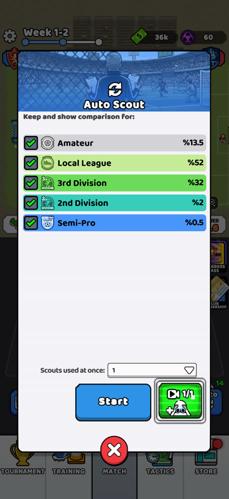

- **"Keep and show comparison for:"** 등급별 체크박스. 체크하지 않은 등급은 자동으로 판매되는 필터로 보입니다(추정).
- `Scouts used at once`로 한 번에 쓸 스카우트 수를 정하고, 광고를 보면 자동 스카우트를 1/1회 추가로 받습니다.
- 메인 화면 `Auto` 버튼 위의 `+14`는 자동 스카우트 남은 횟수 또는 보너스로 보입니다.
- 방치형 장비 게임의 "자동 분해 + 자동 뽑기"와 같은 장치입니다. 후반에 반복 탭을 줄여 주는 편의 기능이자 구독 상품(2배 속도)과 연결된 지점입니다.

## 4. 경기 시스템

- **팀 파워 = ATK + MID + DEF** (290.1 + 299.5 + 297.1 = 886.7 ≈ 886.6). 확인했습니다.
- 경기는 2D 자동 시뮬레이션입니다. 선수 점들이 실제로 패스하고 슛하며, 해설 자막과 `GOAL` 연출이 나옵니다.
- **스킬 효과가 확률 수치로 표현된다**는 점(패스 정확도 +1%, 파워 슛 확률 +1%)으로 보아, 단순 파워 비교가 아니라 **패스·슛 같은 이벤트를 확률로 굴리는 시뮬레이션**으로 보입니다.
  - 그래서 초반 영상에서 내가 파워가 더 높아도 0-3으로 지는 결과가 나올 수 있습니다.
  - 886.6 vs 845.1(약 5% 우위) 경기는 2-1 진행 중이었습니다.
- 경기 시계가 있어 한 경기가 일정 시간 이어지고, 그동안 플레이어는 계속 스카우트를 돌립니다. **경기를 보면서 다음 경기를 준비하는 병행 구조**입니다.

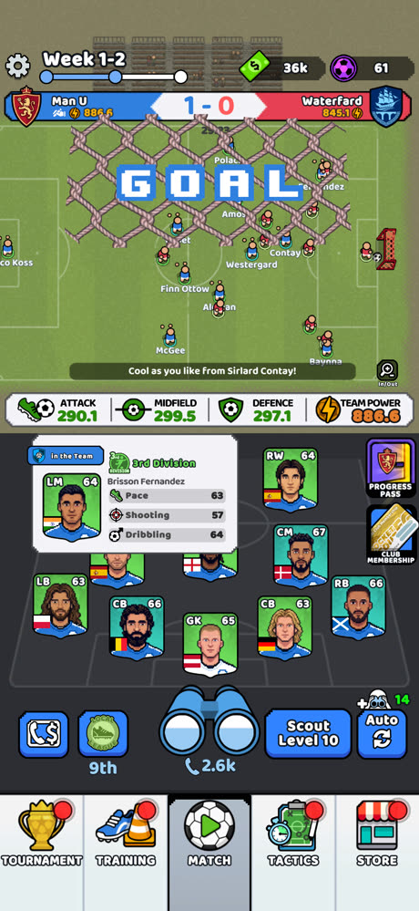

## 5. 리그 / 진행도 (확인)

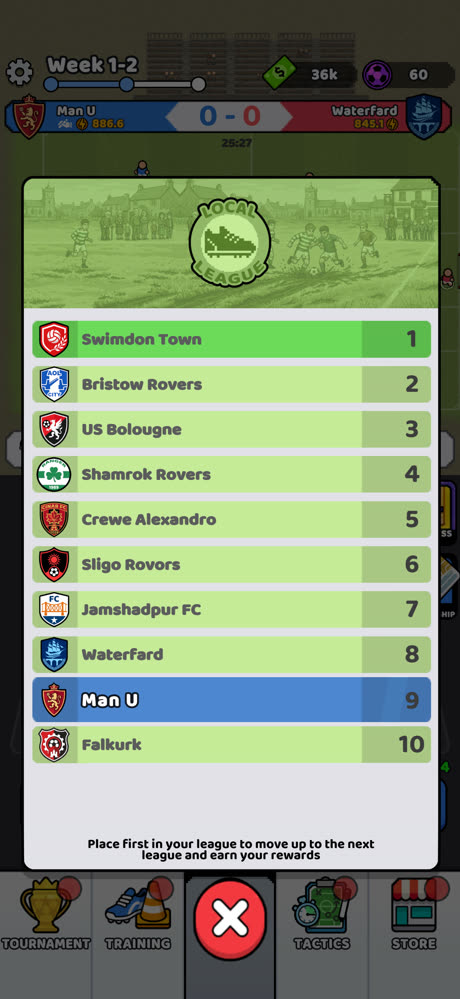

- 리그 하나에 10개 팀, **1위를 하면 다음 리그로 승격**하고 보상을 받습니다("Place first in your league to move up to the next league and earn your rewards").
- `Week 1-2`의 1은 시즌, 2는 주차로 추정됩니다.
- 팀 이름은 **실존 구단 이름을 살짝 바꾼 패러디**입니다. Swimdon Town(Swindon), Bristow Rovers(Bristol), US Bolougne(Boulogne), Shamrok Rovers, Crewe Alexandro, Sligo Rovors, Jamshadpur FC, Waterfard(Waterford), Falkurk(Falkirk).
- 승격 사다리는 선수 등급과 같습니다: Local League → 3rd Division → 2nd Division → Semi-Pro → Professional → Elite → World Class → (Superstar).

## 5-1. 경기장 수익: 방치형 수입 (확인)

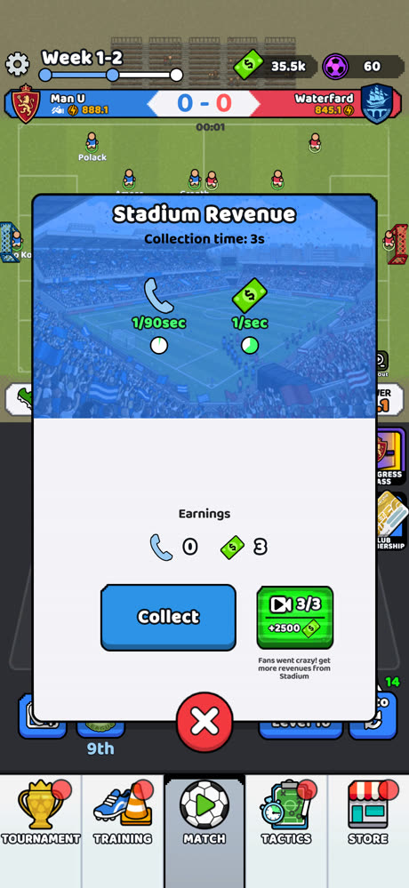

- `Stadium Revenue`: **스카우트권 1개/90초, 현금 1/초**가 자동으로 쌓이고, `Collect`를 눌러 받음
- 광고를 보면 현금 +2500 (3/3회, "Fans went crazy!")
- 계산하면 하루 최대 스카우트권 960개, 현금 86.4k. 스카우트 Lv11 업그레이드 비용(55.7k)과 비교하면 **방치 수입만으로는 하루에 한 레벨 정도**만 오름. 판매 수입, 광고, 결제로 그 간격을 메우게 하는 구조

## 5-2. TRAINING: 재화별 훈련 캠프 (확인)

| 캠프 | 난이도 | 보상 | 입장권 |
|---|---|---|---|
| Penalty Challenge | 1-4 | 스톱워치 212 (스킬 소환 재화) | 골키퍼 장갑 2/2 |
| Freekick Challenge | 1-5 | 전술 카드 104 (연구 재화) | 파란 축구화 2/2 |
| Street Ball | 1-5 | 스카우트권 95 + 현금 6000 | 회색 축구화 2/2 |

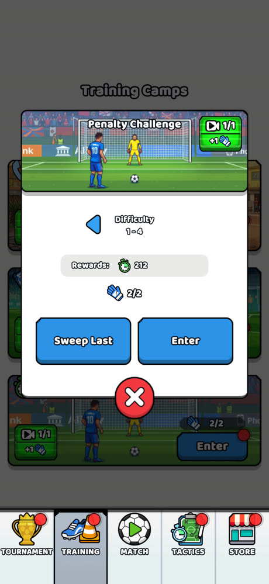 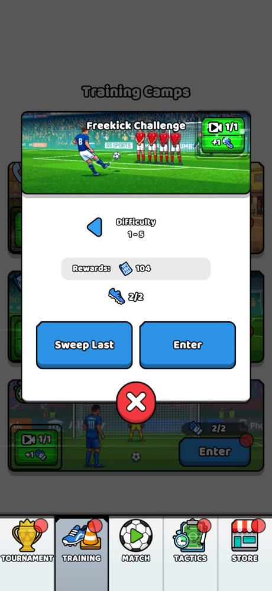 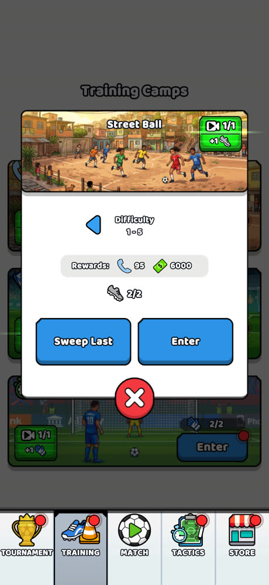

- 방치형 RPG의 **요일/재화 던전**과 같은 구조입니다. **캠프마다 한 가지 재화를 집중해서 줍니다.**
- 입장권은 하루 2회로 추정되고, 광고를 보면 +1회입니다.
- **`Sweep Last`**: 이미 깬 최고 난이도를 플레이 없이 바로 클리어하는 소탕 기능입니다. 미니게임을 처음 한 번만 직접 하면 이후에는 탭 한 번으로 끝납니다.
- 앞서 "축구화 = 트레이닝 아이템"으로 추정한 것은 맞았고, **장갑·축구화가 캠프별 입장권**이라는 것을 확인했습니다.

## 5-3. TOURNAMENT: Master Cup, 비동기 대전 (확인)

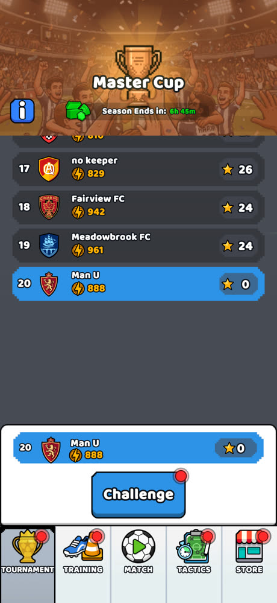 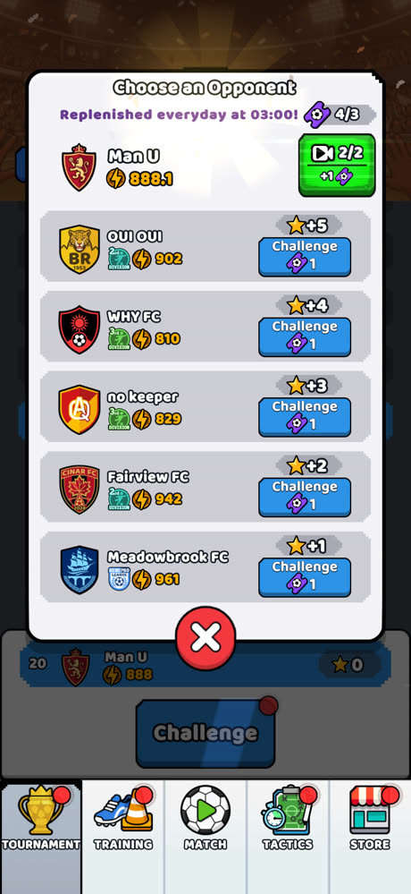

- 정해진 기간 동안 열리는 시즌형 이벤트입니다("Season Ends in: 6h 45m"). 시즌 보상은 초록 보석 상자입니다.
- **20개 팀이 별(★) 점수로 순위**를 겨룹니다. 나는 20위(★0), 17~19위는 ★24~26입니다.
- **상대 선택**: 상대 5팀이 각자의 팀 파워·리그 배지와 함께 나오고, 이기면 받는 별이 ★+5 ~ ★+1로 다릅니다.
  - 상대 팀 이름이 `OUI OUI`, `WHY FC`, `no keeper`처럼 **다른 플레이어가 직접 지은 이름**으로 보여, **다른 유저의 팀과 싸우는 비동기 PvP**로 추정됩니다.
  - 별 점수가 상대 파워 순서와 일치하지 않습니다. 961 상대가 ★+1, 902 상대가 ★+5입니다. 일부러 "약한 상대 + 높은 별"을 찾는 선택 재미를 준 것으로 보입니다(추정).
- 한 번 도전할 때마다 **보라 티켓 1장**이 들고, 티켓은 **매일 03:00에 다시 채워집니다**. 광고를 보면 +1장(2/2)입니다. 앞서 "티켓 = 토너먼트 입장권"으로 추정한 것이 맞았습니다.
- 보유량 4/3처럼 **상한을 넘겨서 가질 수 있어**, 패스나 패키지로 받은 티켓이 버려지지 않습니다.

## 6. 성장 시스템

### 6-1. TACTICS → Tactics: 영구 버프 트리 3종 (확인)

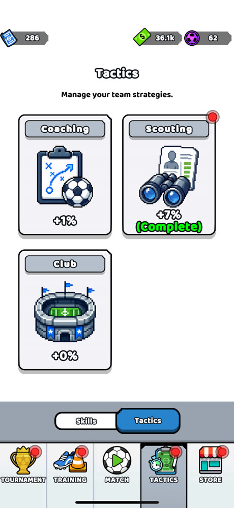

| 트리 | 보너스 | 상태 |
|---|---|---|
| Coaching | +1% | 진행 중 |
| Scouting | +7% | **Complete** |
| Club | +0% | 미착수 |

- 트리별로 % 보너스를 줍니다. 무엇에 대한 보너스인지는 화면에 없는데, 팀 파워나 해당 분야 효율로 추정됩니다.
- **Coaching 트리**(확인)
  - 노드: Pinpoint Passing Tier I (패스 정확도 +1%, 1/5) → 드리블 계열(0/5) → 두 갈래(골 계열, GK 장갑 계열, 잠김) → 다음 노드(잠김)
  - 업그레이드 비용: **시간 10분 + 전술 카드 42장**
  - **"Another talent upgrade is already in progress"**: 한 번에 하나만 연구할 수 있는 **시간제 연구**입니다(클래시 오브 클랜식). 접속을 다시 하게 만들고, 시간 단축 결제로 이어질 수 있는 장치입니다.

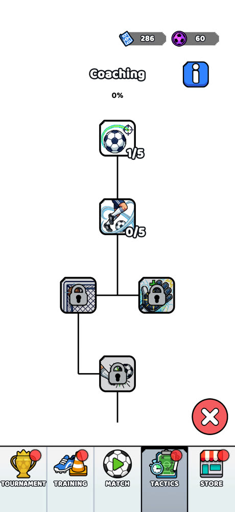

### 6-2. TACTICS → Skills: 팀 스킬 뽑기와 장착 (확인)

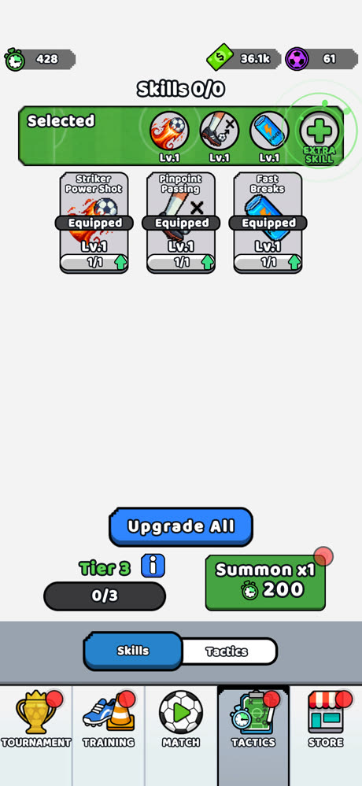

- 장착 슬롯 3개 + **EXTRA SKILL 4번째 슬롯**(유료, $4.99 상품)
- 지금 보유한 스킬
  - **Striker Power Shot**: 슛이 파워 슛이 될 확률 +1%, 다음 레벨 +2%
  - **Pinpoint Passing**: 패스 정확도 +1%
  - **Fast Breaks**: 역습 관련
- 스킬마다 레벨과 조각 수(1/1)가 있고 업그레이드할 수 있습니다. `Upgrade All` 버튼이 있습니다.
- **Summon x1 = 스톱워치 재화 200개**. 소환 등급(Tier 2 1/2 → Tier 3 0/3)이 소환 횟수에 따라 오르는, 소환 레벨 방식입니다.
- 장착한 스킬은 경기 스코어보드 아래 아이콘으로 표시됩니다.

## 7. 재화 구조 (확인 + 일부 추정)

| 아이콘 | 이름(추정) | 얻는 곳 | 쓰는 곳 |
|---|---|---|---|
| 초록 지폐 | 현금 | **경기장 수익(1/초)**, 선수 판매, 경기, Street Ball, 광고(+2500), 패스 | **스카우트 레벨 업그레이드** |
| 보라 공 | 젬 (프리미엄) | 매일 무료 10, 광고(+10), 결제 | 상점, 가속 등 |
| 파란 전화기 | **스카우트권** | **경기장 수익(1/90초)**, Street Ball, 광고(+50), 패스, 구독, 패키지 | 스카우트 1회에 1개 |
| 파란 전술판 카드 | 전술 카드 | **Freekick Challenge**, 패키지 | Coaching/Scouting/Club 트리 연구 |
| 초록 스톱워치 | 스킬 소환 재화 | **Penalty Challenge**, 패스, 패키지 | 스킬 소환(200) |
| 보라 티켓 | 토너먼트 티켓 | **매일 03:00 충전**, 광고, 패스, 패키지 | Master Cup 도전 1회 |
| 장갑 / 축구화 | 훈련 캠프 입장권 | 매일 충전(추정), 광고, 패스 | Penalty / Freekick / Street Ball 입장 |

**재화와 콘텐츠가 1:1로 대응합니다.** 훈련 캠프 하나가 재화 하나를 공급하고, 그 재화가 성장 시스템 하나(연구, 스킬, 스카우트)로 들어갑니다. 재화는 8종(입장권 포함)으로 많지만 각각 공급처와 소비처가 분명해서 구조는 깔끔합니다. 또 **패키지 하나에 여러 재화를 섞어 팔기 좋게** 설계되어 있습니다.

```
경기장 수익 ─┬─ 현금 ──────────→ 스카우트 레벨
             └─ 스카우트권 ─────→ 스카우트(선수)
Street Ball ─── 스카우트권 + 현금
Freekick ────── 전술 카드 ──────→ Coaching/Scouting/Club 연구 (시간제)
Penalty ─────── 스톱워치 ───────→ 스킬 소환
Master Cup ──── (티켓 소비) ────→ 시즌 보상
리그 경기 ───── 승점 → 승격, Progress Pass 진행
```

## 8. 수익 모델 (원화, 확인)

### 8-1. 상점

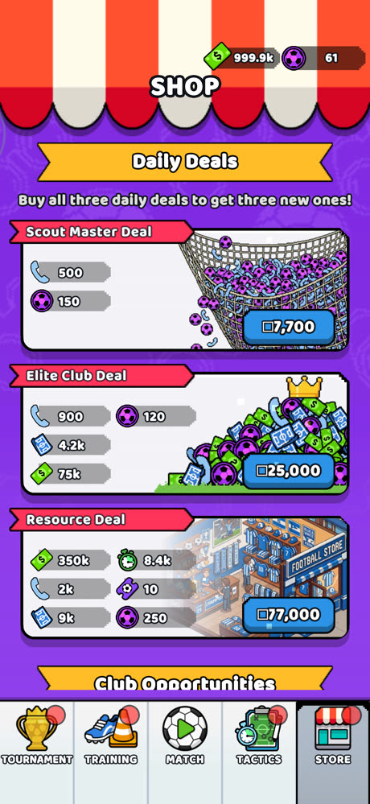 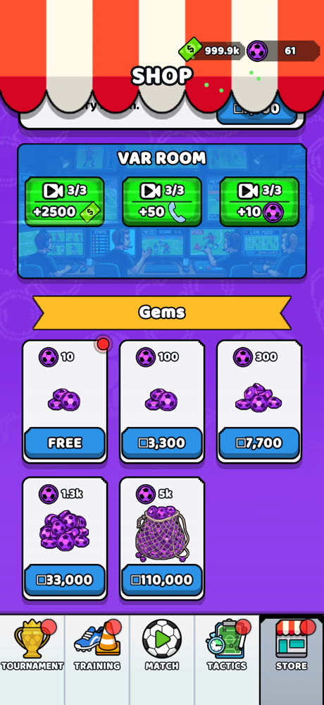

**Daily Deals**: "세 개를 모두 사면 새 특가 세 개가 열림"
| 상품 | 구성 | 가격 |
|---|---|---|
| Scout Master Deal | 스카우트 500, 젬 150 | ₩7,700 |
| Elite Club Deal | 스카우트 900, 젬 120, 전술 카드 4.2k, 현금 75k | ₩25,000 |
| Resource Deal | 현금 350k, 스톱워치 8.4k, 스카우트 2k, 티켓 10, 전술 카드 9k, 젬 250 | ₩77,000 |

**VAR ROOM (보상형 광고)**: 하루 3회씩 현금 +2500, 스카우트 +50, 젬 +10. 광고 시청 공간을 "VAR 판독실"로 꾸민 테마가 재치 있습니다.

**Gems**
| 수량 | 가격 | 젬 1개당 |
|---|---|---|
| 10 | 무료(매일로 추정) | – |
| 100 | ₩3,300 | 33원 |
| 300 | ₩7,700 | 25.7원 |
| 1.3k | ₩33,000 | 25.4원 |
| 5k | ₩110,000 | 22원 |

- 그 밖에 `Club Opportunities` 섹션이 있습니다(스폰서십이나 스타 선수 판매로 추정, App Store의 Jersey/Bus Sponsorship, 스타 선수 상품).
- 같은 ₩7,700으로 젬 300개 또는 스카우트 500 + 젬 150을 살 수 있습니다. **스카우트 패키지가 훨씬 이득처럼 보이게** 가격을 배치한 미끼 가격 구성입니다.

### 8-2. 주간 구독: Official Club Membership ₩6,600

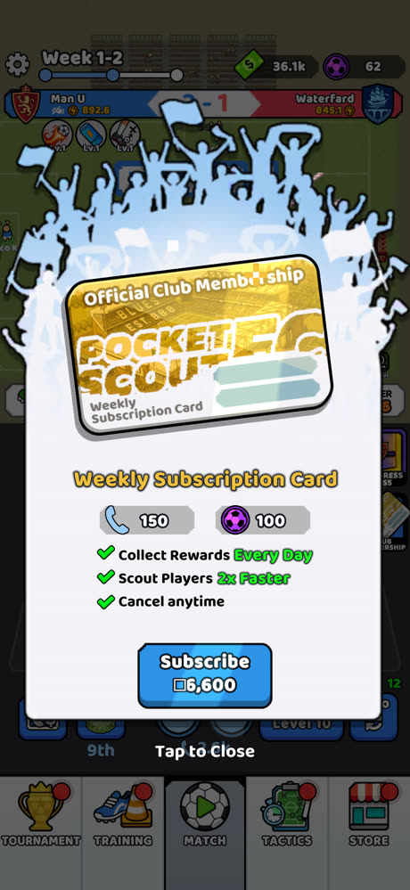

- 바로 지급: 스카우트 150, 젬 100
- 매일 보상, **스카우트 속도 2배**, 언제든 해지 가능
- 메인 화면에 고정 버튼이 있고, 경기 중에도 팝업으로 노출됩니다.

### 8-3. Progress Pass ₩17,000

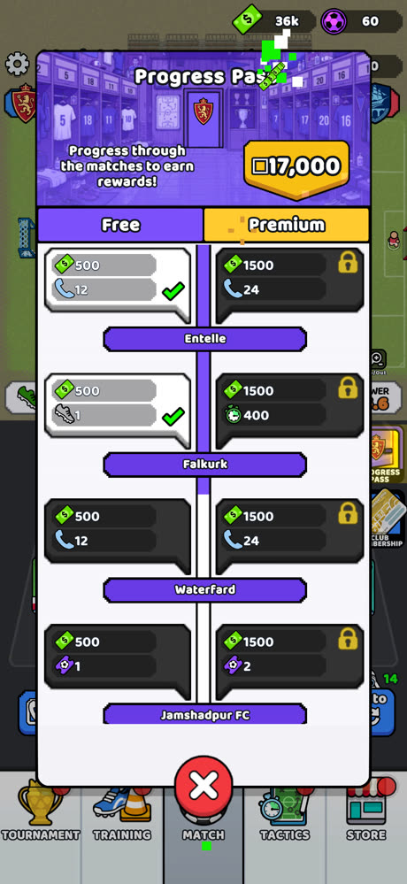

- Free / Premium 두 트랙. **보상 단계가 리그 상대 팀 이름**(Entelle, Falkurk, Waterfard, Jamshadpur FC)으로 되어 있어서, 리그 경기를 치를수록 패스가 진행됩니다.
- 무료 트랙은 현금 500에 스카우트 12, 축구화, 티켓 중 하나. 프리미엄 트랙은 현금 1500(3배)에 스카우트 24, 스톱워치 400, 티켓 2 중 하나.

## 8-4. 심화 분석: 숫자로 본 설계

> 스크린샷 수치를 바탕으로 계산했습니다. 오프라인 누적 상한, 캠프 입장권 충전 주기, 포지션 분포는 확인하지 못해서 가정을 붙였습니다.

### A. 시간 단위별 루프 계층

| 시간 단위 | 하는 일 | 장치 |
|---|---|---|
| **초** | 스카우트 탭 → 비교 → 영입/판매 | 쌍안경 버튼, ↑↓ 화살표 |
| **분** | 경기 1판 자동 진행, Coaching 연구(10분~) | 경기 시계, 해설 자막, 연구 타이머 |
| **시간** | 경기장 수익 쌓이기, 토너먼트 시즌 마감 | Collect, "Season Ends in 6h 45m" |
| **하루** | 03:00 초기화: 토너먼트 티켓, 광고 보상 3회, 무료 젬, 일일 특가 | 빨간 알림 점 |
| **주** | 리그 주차(Week 1-2), 주간 구독 | 진행 게이지 |
| **시즌** | 리그 1위 → 승격, Progress Pass | 리그 순위표, 패스 |

초 단위 루프가 분, 시간, 하루 단위 루프 위에 겹겹이 쌓여 있어서 **언제 들어와도 할 일이 있게** 만들었습니다. 방치형 장르의 정석적인 구조입니다.

### B. 무과금 하루 자원 공급량 (추정)

| 공급원 | 스카우트권 | 현금 |
|---|---|---|
| 경기장 수익 (24시간 기준) | 960 (1/90초) | 86,400 (1/초) |
| VAR 룸 광고 3회 | 150 | 7,500 |
| 경기장 광고 3회 | – | 7,500 |
| Street Ball 3회 (2회 + 광고 1회) | 285 | 18,000 |
| **합계** | **약 1,400** | **약 120k** + 선수 판매 + 경기 보상 |

- 스카우트 Lv11 비용 55.7k는 **하루 공급량의 절반 정도**입니다. 다만 레벨이 오를수록 비용이 커질 것이라 실제 속도는 더 느려질 것으로 추정됩니다.
- 경기장 수익은 **오프라인 누적 상한**이 있을 가능성이 큽니다. 상한이 있다면 하루에 여러 번 접속해야 위 수치가 나옵니다. 이것이 접속 빈도를 끌어올리는 핵심 장치일 것입니다.

### C. 스카우트 기대값: "포지션 분산"이 실제 희귀도를 높인다

하루 1,400회 스카우트 기준:

| 등급 | Lv10 확률 | 하루 기대 획득 | Lv11 확률 | 하루 기대 획득 |
|---|---|---|---|---|
| 2nd Division | 2% | 28명 | 4% | 56명 |
| Semi-Pro | 0.5% | 7명 | 1% | 14명 |
| Professional | 0% | 0 | 0.05% | 0.7명 |

숫자만 보면 넉넉해 보이지만, **내가 원하는 포지션**으로 한정하면 이야기가 달라집니다.
- 포지션은 GK, LB, CB, RB, CM, CAM, LM, LW, RW, ST 등 10~12종입니다.
- 균등하게 나온다고 가정하면 특정 포지션의 Professional 1명은 약 **24,000회 스카우트, 무과금 약 17일 분량**이 필요합니다.
- 11자리를 모두 같은 등급으로 채우려면 몇 달이 걸립니다.

→ **확률표는 너그러워 보이지만 포지션 분산이 실제 희귀도를 10배 이상 높입니다.** 자동 스카우트(등급 필터, 한 번에 여러 회)가 꼭 필요한 이유이고, "스카우트 2배 속도" 구독이 팔리는 이유이기도 합니다.

### D. 결제 상품의 원화 가치

젬 1개를 약 25.7원(300젬 = ₩7,700 기준)으로 놓고 계산했습니다.

| 상품 | 계산 | 해석 |
|---|---|---|
| Scout Master ₩7,700 | 젬 150 ≈ ₩3,850 → 스카우트 500 ≈ ₩3,850 | **스카우트 1회 ≈ 7.7원** |
| 무과금 하루 스카우트 1,400회 | 1,400 × 7.7 | 하루 약 **₩10,800어치**를 무료로 지급 |
| 주간 구독 ₩6,600 | 즉시 지급 스카우트 150 + 젬 100 ≈ ₩3,700 + 매일 보상 + **2배 속도** | 핵심 가치는 재화가 아니라 **속도** |
| Progress Pass ₩17,000 | 단계당 프리미엄 보상: 현금 1,500 + 스카우트 24 | 단계 하나의 가치는 작음. **단계 수가 많아야** 이득 |

- 스카우트권은 무료로 많이 풀리기 때문에, 스카우트권만 파는 상품은 가성비가 약합니다. 그래서 **속도(구독), 슬롯(Extra Skill), 시간(연구 가속), 확정 스타 선수** 같은 **"무료로는 못 얻는 것"을 파는 쪽으로 수익 모델이 짜여 있습니다.**
- 일일 특가 "세 개를 다 사야 새 특가가 열림"은 고액 결제자에게 판매 단계를 계속 열어 주는 장치입니다(₩7,700 → ₩25,000 → ₩77,000).

### E. 리텐션 장치

1. **누적형 수입**: 경기장 수익을 회수하러 다시 접속
2. **시간제 연구**: 연구는 한 번에 하나만 가능 → 끝나면 다음 연구를 걸러 접속
3. **하루 초기화(03:00)**: 토너먼트 티켓, 광고 보상 3회, 무료 젬 10, 캠프 입장권
4. **시즌 마감 타이머**: 토너먼트 남은 시간 표시
5. **확률 미리보기**: 다음 레벨에서 새 등급(Professional 0.05%)이 열린다는 기대감
6. **빨간 알림 점**: 하단 탭 5개 모두에 상시 표시
7. **승격 목표**: 10팀 중 1위라는 분명한 단기 목표

### F. 플레이어 현재 상태 진단 (Week 1-2 시점)

| 항목 | 값 | 진단 |
|---|---|---|
| 팀 파워 | 888 | 리그 상대(Waterfard 845)보다 높지만 9위 → 초반 경기를 놓친 것으로 보임 |
| 선수 등급 | 대부분 3rd/2nd Division (능력치 62~69) | Lv10 확률에 맞는 평균 수준 |
| 스카우트 | Lv10, 보유 2.6k회 | **스카우트권은 넉넉하고 현금(36k / 55.7k)이 병목** |
| 토너먼트 | 20위, ★0 | 티켓 4/3로 상한 초과. **티켓이 남고 있으니 바로 쓰는 게 좋음** |
| 전술 | Scouting 완료(+7%), Coaching 진행 중, Club 미착수 | Club 트리가 비어 있음 |

→ 지금은 현금이 병목입니다. 스카우트권 2.6k를 자동 스카우트로 돌려 **낮은 등급을 모두 판매해 현금으로 바꾸고**, 그 현금으로 스카우트 레벨을 올리는 흐름이 효율적일 것으로 보입니다(추정).

### G. 아직 확인하지 못한 것 (다음에 찍어 주시면 좋은 화면)

| 궁금한 점 | 필요한 화면 |
|---|---|
| 등급별 선수 판매 가격 | Sell 버튼을 누른 직후 받는 현금 |
| 경기 1판의 실제 시간과 승리 보상 | 경기 종료 화면 (FULL-TIME 보상) |
| 승격 보상과 다음 리그 상대들의 파워 | 리그 1위 달성 화면, 3rd Division 리그 순위표 |
| Club 트리와 Scouting 트리의 노드 | TACTICS → Club, Scouting 상세 |
| Club Opportunities 상품 (스폰서, 스타 선수) | 상점 아래쪽 |
| 경기장 수익 오프라인 상한 | 오래 접속하지 않은 뒤의 Collect 화면 |
| 훈련 캠프 미니게임이 조작형인지 자동인지 | Penalty / Freekick 플레이 화면 |
| 스카우트 레벨 비용이 어떻게 늘어나는지 | Lv11, Lv12 업그레이드 비용 |
| 토너먼트 시즌 보상 | Master Cup의 ⓘ 정보 화면 |

## 9. 강점과 약점

**강점**
- "탭 → 비교 → 영입/판매" 한 동작으로 즉시 숫자가 오르는 쾌감
- **선수 등급 = 리그 단계** 사다리 하나로 모든 진행을 설명해서 이해하기 쉬움
- 확률표를 공개하고 다음 레벨 확률을 미리 보여 줘서 업그레이드 동기를 줌
- 경기를 보는 동안 스카우트를 돌리는 병행 구조, 해설 자막으로 볼거리 확보
- 시스템마다 전용 재화를 둬서 패키지 구성이 쉽고, 광고 보상을 "VAR 룸"처럼 테마에 녹임

**약점 / 리스크**
- 확률 이벤트 시뮬레이션이라 **파워가 높아도 지는 경우**가 생기고, 리뷰에서 불공정하다는 불만이 나옴
- 재화 7종, 시간제 연구, 상시 알림 점, 경기 중 팝업 등으로 **복잡도와 결제 압박이 빠르게 늘어남**
- 구단과 선수 이름 패러디(Man U 같은 팀 이름 설정, Erlin Holland 같은 스타 선수 상품)의 IP 리스크
- 성장 속도 밸런스 불만 (스카우트 Lv11 비용 55.7k인데 보유 36k)

## 10. 조기축구 게임 기획에 주는 시사점

1. **등급 = 리그 사다리를 한국 축구 체계로 바꾸기**
   `동네 조기축구 → 구 리그 → 시·도 리그 → K7 → K6 → K5 → K4 → K3 → K리그 → 국가대표`
   한국 디비전 리그(K7~K3)는 실제로 존재해서, 원작의 Amateur → Superstar보다 한국 유저에게 더 생생합니다.
2. **선수 캐릭터에 조기축구 정체성 부여**: 직업(택배기사, 치킨집 사장, 대학생, 전직 선출), 나이, 체력. 예를 들어 Physical 대신 "새벽 컨디션", "회식 후유증" 같은 조기축구다운 변수를 넣을 수 있습니다.
3. **능력치는 6개 유지, 포지션별로 3개만 요약**: 원작 UI가 정보량을 잘 조절했으니 그대로 참고할 만합니다.
4. **확률표 공개 + 다음 레벨 미리보기**를 그대로 가져오세요(국내 확률 표시 의무와도 맞음).
5. **경기 결과에 이유 보여 주기**: 원작의 가장 큰 불만이 "파워가 높은데 진다"입니다. 하이라이트 자막에 "상대 GK 선방 6회", "후반 체력 저하" 같은 이유를 붙이면 불만이 줄어듭니다.
6. **재화는 "콘텐츠 하나에 재화 하나" 원칙을 지키되 수를 줄이기**: 현금(회비), 스카우트권(연락처), 젬, 연구 재화 정도가 적당합니다. 원작의 8종은 캐주얼 유저에게 많습니다.
7. **훈련 캠프를 조기축구 미니게임으로**: 원작의 페널티 / 프리킥 / 스트리트볼은 각각 **승부차기 내기 / 동네 풋살 / 운동장 족구** 같은 식으로 바꿀 수 있습니다. 소탕 기능(`Sweep Last`)은 꼭 넣으세요.
8. **비동기 PvP 토너먼트에 "동네 대항전" 테마**: 다른 유저 팀과의 대전을 "○○구 조기축구 대회" 시즌으로 만들고, 유저가 지은 팀 이름을 보여 주면 커뮤니티 느낌이 납니다.
9. **수익화 테마 현지화**
   - 원작 VAR 룸 → **"벤치 휴식"** 광고 보상
   - 원작 스폰서십 → **동네 가게 스폰서**(치킨집, 철물점, 부동산 유니폼)
   - 원작 Club Membership → **"정회원 회비"** 주간 구독
   - 원작 Progress Pass → **"시즌 회비 패스"**
10. **실존 구단과 선수 이름 패러디는 피하기**. 가상의 동네 팀 이름(○○동 FC, 새벽FC, 막걸리 유나이티드)이 오히려 조기축구 감성에 맞습니다.

---

### 부록: 스크린샷 목록 (`images/screens/`)

| 파일 | 내용 |
|---|---|
| 01 | Tactics (Coaching / Scouting / Club) |
| 02 | 주간 구독 (Official Club Membership) |
| 03 | 상점: Daily Deals |
| 04 | 상점: VAR ROOM, Gems |
| 05 | 스킬 상세 (Pinpoint Passing, 장착 중) |
| 06 | 스킬 목록, 소환 |
| 07 | 스킬 상세 (Striker Power Shot, 미장착) |
| 08 | 스카우트 비교 팝업 (2nd Division LM 66) |
| 09 | 경기 중 골 연출, 선수 카드 요약 |
| 10 | 자동 스카우트 설정 |
| 11 | 로컬 리그 순위표 |
| 12 | 스카우트 확률 (Lv10 → Lv11) |
| 13 | Progress Pass |
| 14 | 메인 경기 화면 |
| 15 | Coaching 연구 팝업 (시간제) |
| 16 | Coaching 트리 |
| 17 | 훈련 캠프: Penalty Challenge |
| 18 | 훈련 캠프: Freekick Challenge |
| 19 | 훈련 캠프: Street Ball |
| 20 | 토너먼트: 상대 선택 |
| 21 | 토너먼트: Master Cup 순위 |
| 22 | 스카우트 비교 팝업 (ST, 핵심 능력치 2개) |
| 23 | 경기장 수익 (방치 수입) |
