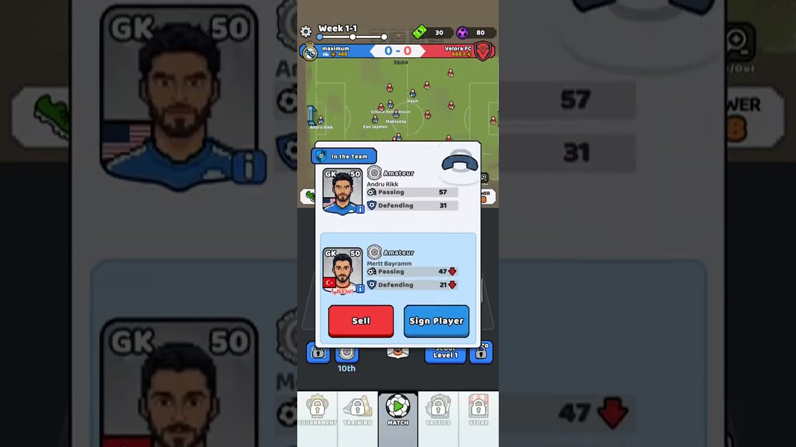
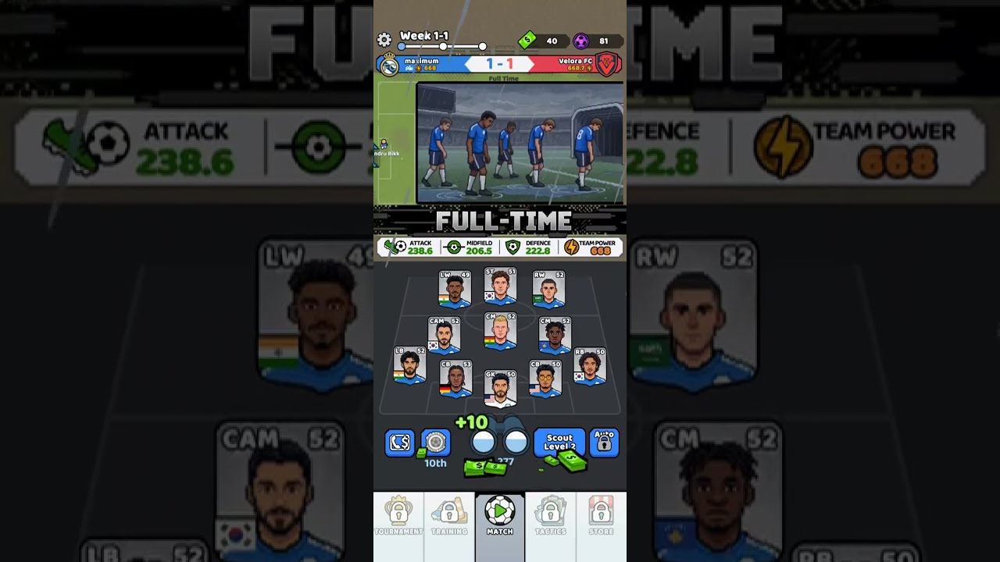
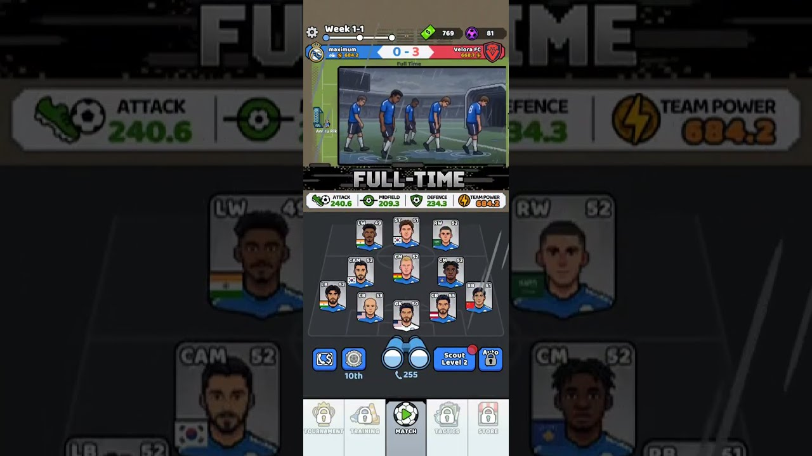

# Pocket Scout FC 게임 분석

- 분석 대상 영상: [Pocket Scout FC Gameplay](https://youtu.be/HXHRJK8GDqQ) (채널: Maximumandroid)
- 참고 자료: [App Store 페이지](https://apps.apple.com/us/app/pocket-scout-fc/id6776583457)

> **분석 범위 안내**: 클라우드 환경에서 YouTube가 봇 확인을 요구해 영상 전체를 내려받지 못했습니다.
> 이 문서는 YouTube가 제공하는 영상 캡처 프레임 3장(초반/중반/후반)과 썸네일,
> 그리고 App Store 정보를 근거로 작성했습니다. 프레임에서 직접 확인한 내용과 추정한 내용을 구분해 적었습니다.

## 1. 기본 정보

| 항목 | 내용 |
|---|---|
| 개발사 | Mobge Ltd (튀르키예의 하이퍼캐주얼/캐주얼 모바일 개발사) |
| 장르 | 캐주얼 **방치형(idle) 축구 팀 경영 시뮬레이션** |
| 플랫폼 | iOS / iPadOS (Android 출시 여부는 확인하지 못함) |
| 버전 | 0.1.1(6월 11일) → 0.2.8 (아직 1.0 이전, 업데이트가 잦은 소프트 런칭 단계) |
| 수익 모델 | 무료 + 광고 + 인앱 결제 ($2.99 ~ $14.99) |
| 평점 | 4.7 / 5 (리뷰 225개), 스포츠 무료 순위 160위권 |
| 언어 | 영어만 지원 |
| 화면 | 세로 화면, 한 손 조작 |

## 2. 아트·UI

- **픽셀 아트 선수 얼굴과 깔끔한 플랫 UI**를 섞은 스타일. 썸네일은 고해상도 일러스트(터널 입장 장면)에 픽셀 얼굴을 합친 마케팅용 이미지입니다.
- 화면 구성(위에서 아래로)
  1. **상단 바**: 설정, 진행도(`Week 1-1`, 진행 게이지), 재화 2종(초록색 현금, 보라색 공 토큰)
  2. **스코어보드**: 내 팀 이름·팀 파워 vs 상대 팀(`Velora FC`, 668.7) 이름·팀 파워
  3. **경기 화면**: 위에서 본 2D 피치에 점처럼 작은 선수들과 이름표. 경기가 끝나면 컷신 이미지와 `FULL-TIME` 배너
  4. **팀 스탯 바**: ATTACK / MIDFIELD / DEFENCE / TEAM POWER
  5. **포메이션 보드**: 4-3-3 (LW·ST·RW / CAM·CM·CM / LB·CB·CB·RB / GK). 카드마다 포지션, 능력치, 국기 표시
  6. **핵심 버튼 줄**: 리그 순위(10th), **스카우트 버튼(쌍안경)** 과 남은 횟수, `Scout Level`, `Auto`(잠김)
  7. **하단 탭**: TOURNAMENT · TRAINING · **MATCH** · TACTICS · STORE (초반에는 MATCH만 열려 있음)

## 3. 핵심 게임 루프



```
스카우트(쌍안경 탭) → 선수 1명 등장
   → 지금 그 포지션 선수와 능력치 비교 팝업
   → [Sell] 팔아서 현금 받기  /  [Sign Player] 영입해서 교체
   → 팀 파워 상승 → 경기 자동 진행 → 보상(현금 +10 등)
   → 현금으로 Scout Level 업그레이드 → 더 좋은 선수가 나올 확률 상승 → 반복
```

- **"장비 뽑고 비교하기" 방치형 RPG 구조를 축구로 옮긴 것**입니다. 무기·방어구가 축구 선수로, 공격력이 팀 파워로 바뀐 형태입니다.
- 비교 팝업(프레임 1): `GK 50 · Amateur · Andru Rikk (Passing 57 / Defending 31)` vs 새 선수 `Mertt Bayramm (47↓ / 21↓)`. 숫자가 낮으면 빨간 화살표가 떠서 **0.5초 안에 판단**할 수 있습니다.
- 선수 카드에 보이는 것: 포지션, 종합 능력치, 등급(`Amateur` 등, 등급이 더 있을 것으로 추정), 포지션별 주요 스탯 2개, 국적.

## 4. 수치·밸런스 (프레임에서 읽은 값)

| 시점 | 스코어 | ATK | MID | DEF | TEAM POWER | 현금 | 공 토큰 | 스카우트 |
|---|---|---|---|---|---|---|---|---|
| 초반 | 0-0 | – | – | – | 488 | 30 | 80 | Lv1 |
| 중반 | **1-1** | 238.6 | 206.5 | 222.8 | **668** | 40 | 81 | Lv2, 277 |
| 후반 | **0-3** | 240.6 | 209.3 | 234.3 | **684.2** | 769 | 81 | Lv2, 255 |

 

확인한 점과 추정:
- **TEAM POWER = ATK + MID + DEF** (238.6+206.5+222.8 = 667.9 ≈ 668, 240.6+209.3+234.3 = 684.2). 라인별 수치는 해당 라인 선수들의 능력치 합으로 추정됩니다.
- 상대 `Velora FC` 파워는 **668.7로 고정**. 내 팀이 488에서 668까지 오르자 **비김**, 684로 상대보다 높았는데도 **0-3 패배**. 즉 **파워 비교 + 랜덤 요소**로 결과가 정해지고, 이 랜덤성 때문에 비슷한 상대를 여러 번 상대하게 됩니다.
- 첫 경기 상대가 일부러 강하게 설정돼 있어 **"스카우트를 더 돌려야겠다"는 동기**를 줍니다. 전형적인 튜토리얼 벽입니다.
- 현금이 40에서 769로 크게 늘었습니다. 중복 선수를 **판매(Sell)한 수익**이나 경기 보상이 쌓인 것으로 보입니다. 판매가 주요 수입원이라는 뜻입니다.
- 스카우트 횟수는 277에서 255로 줄었습니다. 넉넉하게 주는 소모형 재화이고, `Auto` 버튼(잠김)은 나중에 **자동 스카우트**를 열어 주는 장치로 보입니다. 이 장르는 보통 자동 뽑기를 광고나 결제와 연결합니다.
- 보라색 공 토큰(80 → 81)은 거의 늘지 않습니다. 프리미엄 재화이거나 별도 성장(훈련, 스킬)용 재화로 추정됩니다.

## 5. 메타 시스템 (패치 노트·하단 탭 기준)

- **리그**: `Week 1-1` 형식의 주차 진행과 순위(10th). 새 리그 팀이 계속 추가되고 있습니다.
- **토너먼트 모드**(0.2.2), **페널티 모드**(0.2.1)
- **트레이닝 모드**와 보상(0.2.4)
- **전술/클럽 전략**(0.2.1)과 **선수 카드 스킬**, 스킬 슬롯, 스킬 뽑기
- **경기 연출 추가**: 프리킥, 파울, 옐로·레드 카드(0.2.7)
- **스폰서십**(유니폼, 구단 버스) 상품, 클럽 진행도 저장 방식 개선(0.2.8)
- 기능은 **하단 탭이 잠겨 있다가 진행에 맞춰 하나씩 열리는 방식**입니다. 초반 인지 부담을 줄이려는 의도입니다.

## 6. 수익 모델

| 상품 | 가격 | 성격 |
|---|---|---|
| Jersey / Team Bus Sponsorship | $2.99 / $3.99 | 영구 버프(수입 증가로 추정) |
| Official Club Membership | $3.99 | 구독/멤버십 |
| Extra Skill Slot | $4.99 | 성장 상한 확장 |
| Folaryn Balogon / Allisson / Erlin Holland | $4.99 / $6.99 / $9.99 | **스타 선수 직접 판매** |
| Progress Pass | $9.99 | 배틀패스 |
| Medium Prestige / Elite Club Deal | $4.99 / $14.99 | 묶음 패키지 |

- 광고가 들어가 있고(연령 등급 표기에 명시), 하이퍼캐주얼 회사답게 **광고(보상형 광고) + 소액 결제** 혼합형입니다.
- 스타 선수 이름이 **실존 선수 이름을 살짝 바꾼 것**(Erling Haaland → Erlin Holland, Alisson → Allisson, Folarin Balogun → Folaryn Balogon)입니다. 라이선스 없이 친숙함을 노린 방식이지만 법적 위험이 있습니다.

## 7. 강점과 약점

**강점**
- 루프가 극도로 단순합니다. "탭 → 비교 → 영입/판매" 한 동작으로 즉시 숫자가 오르는 만족감을 줍니다.
- 축구라는 넓은 관심사에 검증된 방치형 장비 뽑기 구조를 입혀 진입 장벽이 낮습니다.
- 포메이션 보드에 선수 얼굴이 하나씩 채워지는 수집 시각화가 좋습니다.
- 짧은 자동 경기와 결과 컷신으로 세션이 짧습니다.

**약점 / 리스크** (App Store 리뷰에서도 지적됨)
- 스카우트·스킬 확률과 페널티 결과에 대한 **불공정 체감**. 프레임 3처럼 파워가 높아도 0-3으로 지는 결과가 그런 인상을 줍니다.
- 성장 속도 밸런스 불만
- 경기를 직접 조작하지 않아 관여도가 낮아 장기 리텐션이 약할 수 있습니다. 그래서 전술, 스킬, 페널티 모드를 계속 추가하는 것으로 보입니다.
- 실존 선수를 패러디한 이름의 IP 리스크
- 영어만 지원

## 8. 조기축구 게임 기획에 주는 시사점

1. **핵심 루프는 그대로 가져올 만합니다**: "동네에서 선수 스카우트 → 비교 → 영입/방출 → 팀 파워 → 자동 경기". 조기축구 테마라면 *동네 아저씨, 대학생, 전직 선출* 같은 **등급 대신 캐릭터 직업**을 쓰면 차별화가 됩니다.
2. **결과 랜덤성은 이유가 보이게**: 파워가 높은데 지는 경우, "상대 키퍼 선방 7회", "우리 팀 체력 부족" 같은 **이유를 화면에 보여주면** 불공정하다는 불만이 줄어듭니다.
3. **팀 파워를 라인별로 나누는 구조**(ATK/MID/DEF)는 이해하기 쉽고, 나중에 전술 상성(공격형 vs 수비형)을 붙이기도 좋습니다.
4. **기능을 탭 단위로 하나씩 해금**해 첫 5분은 스카우트와 경기만 보여 주세요.
5. **수익화**: 스폰서십(동네 치킨집, 철물점 유니폼 스폰서처럼 조기축구 감성), 시즌 패스, 자동 스카우트 해금. 실존 선수 이름은 피하는 게 좋습니다.
6. **한국어 현지화와 조기축구 문화**(새벽 경기, 막걸리 회식, 회비)는 원작이 다루지 않는 영역이라 차별화 포인트가 됩니다.
